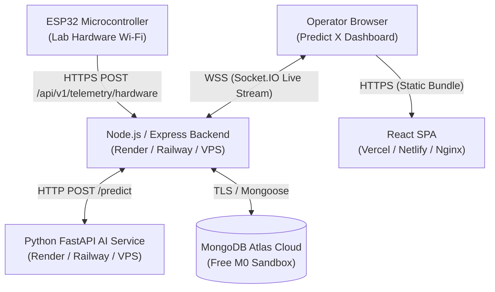

# Predict X: Full-Stack Production & Cloud Hosting Plan

This guide outlines the optimal hosting strategies for the **Predict X** platform, accounting for its multi-service architecture:
1. **React SPA Frontend** (Vite, Recharts, Framer Motion)
2. **Node.js Express Backend** (REST APIs + Socket.IO WebSockets)
3. **Python FastAPI AI Microservice** (Isolation Forest ML Inference)
4. **MongoDB Atlas Cloud Database** (Telemetry & Alert Persistence)
5. **ESP32 Edge Microcontroller** (Physical Wi-Fi Telemetry Stream)

---

## Architecture Overview in Cloud



---

## Strategy Comparison Matrix

| Option | Ideal For | Monthly Cost | WebSockets & ESP32 Support | Setup Time |
|---|---|---|---|---|
| **Option 1: Modern Cloud Microservices** (Render + Vercel + Atlas) | College presentations, portfolio, zero-maintenance | **$0 (Free Tier)** | Excellent (Native SSL & WSS) | 20 mins |
| **Option 2: Single VPS with Docker Compose** (DigitalOcean / AWS / Oracle) | Production grade, live hardware lab demos | **$4 – $6 / mo** (or Free on Oracle) | Best (Dedicated IP & low latency) | 30 mins |
| **Option 3: Instant Ngrok / Cloudflare Tunnel** | Immediate testing without cloud deployment | **$0** | Great for temporary lab testing | 2 mins |

---

## Option 1: Zero-Cost Cloud Deployment (Recommended for Students)

### 1. Database: MongoDB Atlas (Cloud)
- **Service**: [MongoDB Atlas](https://www.mongodb.com/cloud/atlas)
- **Tier**: Free Shared (M0 - 512 MB storage, always free)
- **Steps**:
  1. Create a free cluster named `predict-x-cluster`.
  2. Under **Database Access**, create a user (e.g., `predictx_admin` with a strong password).
  3. Under **Network Access**, add IP `0.0.0.0/0` (Allow access from anywhere).
  4. Copy your Connection String:
     ```
     mongodb+srv://<username>:<password>@cluster0.abcde.mongodb.net/predict_x?retryWrites=true&w=majority
     ```

---

### 2. AI Inference Microservice: Render / Railway
- **Service**: [Render.com](https://render.com) or [Railway.app](https://railway.app)
- **Type**: Web Service (Docker or Python 3.11)
- **Configuration**:
  - **Repository**: Your GitHub repository
  - **Root Directory**: `.`
  - **Build Command**: `pip install -r ai-service/requirements.txt`
  - **Start Command**: `uvicorn ai-service.app.main:app --host 0.0.0.0 --port $PORT`
  - **Environment Variables**:
    - `PYTHON_VERSION`: `3.11.0`
    - `MODEL_DIR`: `ml/saved_models`
- **Output URL**: `https://predict-x-ai.onrender.com`

---

### 3. Backend & WebSocket Server: Render / Railway
- **Service**: Render.com (Web Service - Node)
- **Configuration**:
  - **Root Directory**: `backend`
  - **Build Command**: `npm install && npm run build`
  - **Start Command**: `node dist/server.js`
  - **Environment Variables**:
    ```env
    NODE_ENV=production
    PORT=10000
    MONGODB_URI=mongodb+srv://<user>:<password>@cluster0.mongodb.net/predict_x?retryWrites=true&w=majority
    AI_SERVICE_URL=https://predict-x-ai.onrender.com/api/v1
    CORS_ORIGIN=*
    ADMIN_ID=admin
    ADMIN_PASSWORD=predictx2026
    SIMULATION_AUTO_START=false
    ```
- **Output URL**: `https://predict-x-backend.onrender.com`

---

### 4. Frontend Dashboard: Vercel / Netlify
- **Service**: [Vercel](https://vercel.com)
- **Configuration**:
  - **Framework Preset**: Vite
  - **Root Directory**: `frontend`
  - **Build Command**: `npm run build`
  - **Output Directory**: `dist`
  - **Environment Variables**:
    ```env
    VITE_BACKEND_URL=https://predict-x-backend.onrender.com
    ```
  - **Vercel Rewrite Configuration** (`frontend/vercel.json`):
    ```json
    {
      "rewrites": [
        { "source": "/api/v1/:path*", "destination": "https://predict-x-backend.onrender.com/api/v1/:path*" },
        { "source": "/socket.io/:path*", "destination": "https://predict-x-backend.onrender.com/socket.io/:path*" },
        { "source": "/(.*)", "destination": "/index.html" }
      ]
    }
    ```

---

### 5. Connecting Your ESP32 Microcontroller
In your `hardware/esp32_firmware.ino`, simply update the server URL from local IP to your public cloud backend:

```cpp
// Change from local IP to public HTTPS endpoint:
const char* serverUrl = "https://predict-x-backend.onrender.com/api/v1/telemetry/hardware";
```

---

## Option 2: Single VPS with Docker Compose (Production / Dedicated IP)

If you have a cloud VPS (DigitalOcean $4 droplet, AWS EC2 t3.micro, or free Oracle Cloud ARM instance):

1. **SSH into VPS**:
   ```bash
   ssh root@your-vps-ip
   ```
2. **Clone your repository**:
   ```bash
   git clone https://github.com/HimeshBadlani/Cornerstone.git predict-x
   cd predict-x
   ```
3. **Configure Root `.env`**:
   ```bash
   cp .env.example .env
   nano .env
   # Add your MongoDB Atlas URL and production domain
   ```
4. **Launch all containers with one command**:
   ```bash
   docker compose up -d --build
   ```
5. **Nginx Reverse Proxy & Free SSL (Let's Encrypt)**:
   Install Certbot to get automated SSL (`https://` and `wss://`):
   ```bash
   sudo apt install -y nginx certbot python3-certbot-nginx
   sudo certbot --nginx -d yourdomain.com
   ```

---

## Option 3: Instant Live Demo with Ngrok (Zero Setup, 2 Minutes)

For an upcoming project review or college lab test with the ESP32:
1. Start your local backend on port `5000`:
   ```bash
   cd backend && npm run dev
   ```
2. In a separate terminal, expose port 5000:
   ```bash
   ngrok http 5000
   ```
3. Ngrok provides a public URL like: `https://a1b2-c3d4.ngrok-free.app`
4. Put this URL in the ESP32 code:
   ```cpp
   const char* serverUrl = "https://a1b2-c3d4.ngrok-free.app/api/v1/telemetry/hardware";
   ```
5. The ESP32 can now transmit real-time telemetry from anywhere in the college building directly into your laptop's dashboard!
